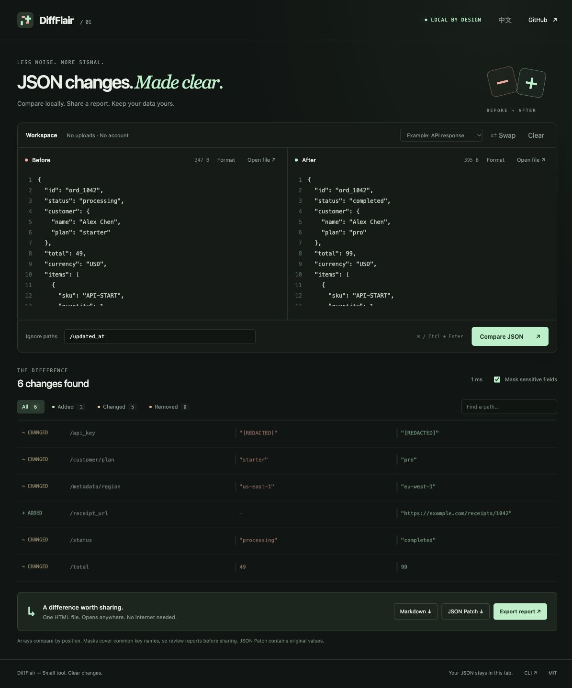

# DiffFlair

**Turn JSON changes into shareable, offline reports.**

A local-first JSON diff workbench. Compare API responses or configuration files, skip noisy fields, and export a readable HTML report your teammate can open without an account or an internet connection.

[Open the workbench](https://kingsley506.github.io/diffflair/) · [中文说明](README.zh-CN.md) · [Contributing](CONTRIBUTING.md)



[See an example offline report](https://kingsley506.github.io/diffflair/docs/example-report.html).

## From two files to a useful handoff

- **See the change, not the formatting.** Object key order does not create differences. Every change has a JSON Pointer path.
- **Keep JSON local.** The workbench runs in your browser. The CLI runs on your machine. Neither needs a backend or an API key.
- **Skip the noise.** Ignore `/deployment/lastUpdated`, or an entire subtree, before comparing.
- **Share a self-contained report.** Export HTML, Markdown, or structured JSON. Sensitive field values are heuristically masked by default.
- **Generate an actual patch.** Export RFC 6902 operations with original values, separately from masked reports.

No runtime dependencies. No build step. Browser workbench + Node.js CLI.

## Try it

Use the [browser workbench](https://kingsley506.github.io/diffflair/) and load the built-in example. Or run the same app locally with Node.js 22+:

```sh
git clone https://github.com/kingsley506/diffflair.git
cd diffflair
npm start
```

Open the local URL printed by the server. `node scripts/serve.mjs` also works directly; no package installation is needed.

Create a report from the included example:

```sh
node bin/diffflair.mjs examples/before.json examples/after.json \
  --ignore /deployment/lastUpdated \
  --format html --output changes.html
```

Open `changes.html` in a browser. It includes the results and styles in one file. The example token values are masked, and the report records the comparison rules.

## CLI

```sh
# Quick overview
node bin/diffflair.mjs before.json after.json

# Markdown for a pull request or incident write-up
node bin/diffflair.mjs before.json after.json --format markdown --output changes.md

# Machine-readable report, with masking enabled
node bin/diffflair.mjs before.json after.json --format json

# Applicable RFC 6902 patch, containing original values
node bin/diffflair.mjs before.json after.json --format patch --output changes.patch.json

# Ignore multiple subtrees
node bin/diffflair.mjs before.json after.json --ignore /meta --ignore /requestId

# Use the result in a check
node bin/diffflair.mjs before.json after.json --check
```

| Option | Behavior |
| --- | --- |
| `--format` | `summary` (default), `json`, `patch`, `markdown`, or `html` |
| `--output FILE` | Write to a file; otherwise print to stdout |
| `--ignore POINTER` | Ignore a path and its descendants; repeat the option for more paths |
| `--no-redact` | Include original values in JSON, Markdown, and HTML reports |
| `--check` | Return `1` when changes exist and `0` when the inputs are equal |
| `--help` | Show usage |

Bad arguments, invalid input, and file errors return `2`. Without `--check`, a successful comparison returns `0`, including when changes exist. `--check` still generates the chosen output.

Paths use [JSON Pointer](https://www.rfc-editor.org/rfc/rfc6901): `/user/name`; escape `~` as `~0` and `/` as `~1`. `--ignore ''` ignores the whole document. An ignored path excludes its entire subtree; it is not a glob.

## Reports and patches

Reports mask values under fields that look sensitive, such as `password`, `token`, `secret`, `authorization`, or `apiKey`, including nested data. Masking is a heuristic: values under unrelated field names, secret text inside strings, and sensitive path names may still appear. Review exports before sharing. `--no-redact` disables masking.

**Patches always contain original values.** A masked value cannot reproduce the intended document. Treat a patch as source data. If paths were ignored, applying the patch reproduces only the included changes; it does not necessarily produce the complete `after` document.

Some partially ignored array additions would leave an invalid index gap; some removals would shift an ignored index. Patch export rejects those cases. Clear the ignore rule or ignore the whole array; report exports remain available.

HTML reports are standalone files with no external runtime assets. They show the comparison rules so the reader can understand what was included.

## Comparison limits

- Inputs must be valid JSON, up to **2 MiB each** and 100 levels deep. The CLI requires UTF-8.
- Arrays are compared **by position**. Reordering items may appear as several modifications; DiffFlair does not detect moves or match objects by ID.
- When an entire container is added, removed, or replaced by another type, ignoring a descendant inside it is ambiguous. DiffFlair asks you to ignore the whole container or remove that ignore rule.
- Numbers use JavaScript's numeric precision. Very large integer IDs should be strings.
- Object key order and JSON whitespace are ignored. Duplicate object keys follow `JSON.parse` behavior: the last value wins.
- Exports describe the selected comparison. Ignored data is excluded, and heuristic masking is not a complete secret scanner.

## Development

```sh
npm test
# equivalent to: node --test
```

The test suite covers the diff engine, patch application, report escaping and masking, and CLI behavior. GitHub Actions runs the suite on Node.js 22 and 24.

Have a messy API response or a report workflow that could be clearer? [Open an issue](https://github.com/kingsley506/diffflair/issues) with a small, anonymized example. See [CONTRIBUTING.md](CONTRIBUTING.md) for the project structure and contribution guidelines.

MIT licensed. If DiffFlair makes your next handoff easier, a star helps other developers find it.
